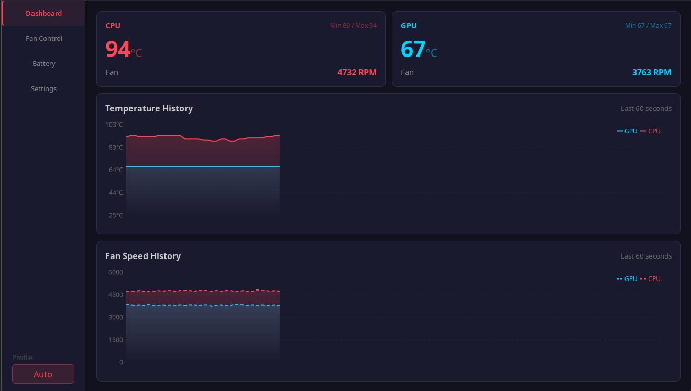
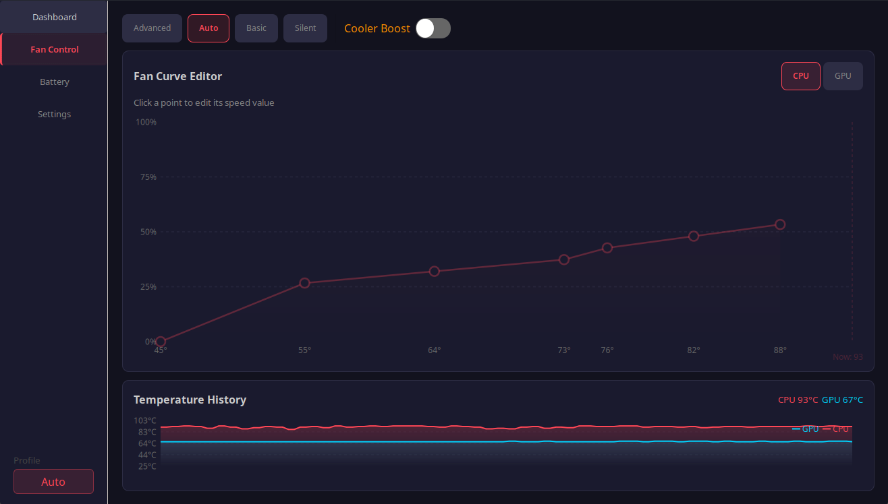
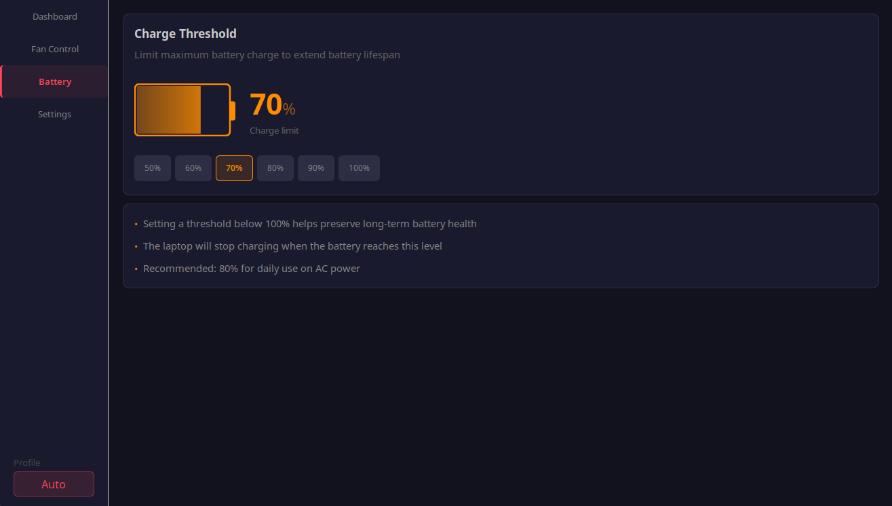
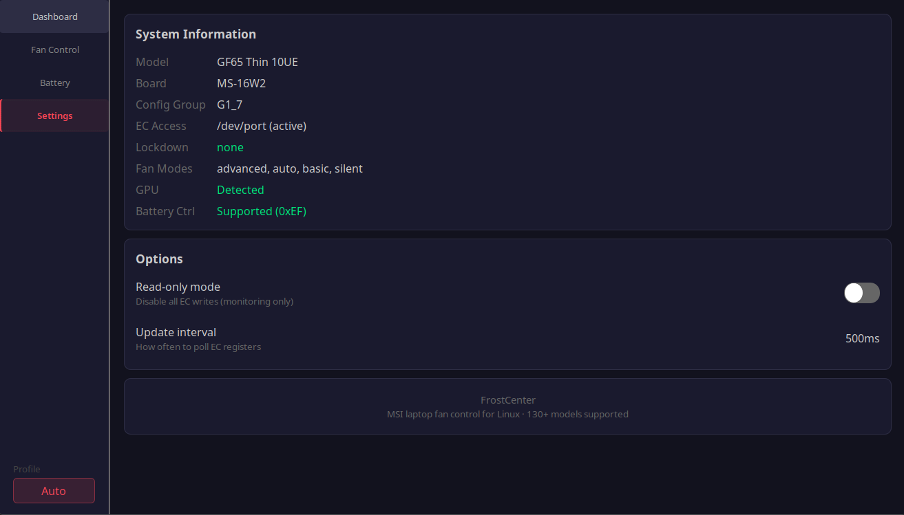

# FrostCenter

MSI laptop fan control and thermal monitoring for Linux.

Dark-themed GTK3 app with real-time temperature graphs, interactive fan curve editor, and battery charge threshold control — no Windows required.


## Screenshots

| Dashboard | Fan Control |
|:---------:|:-----------:|
|  |  |

| Battery | Settings |
|:-------:|:--------:|
|  |  |

## Features

- **Dashboard** — Live CPU/GPU temperature and fan RPM with rolling 60-second graphs
- **Fan Control** — Switch between Auto, Silent, Basic, and Advanced profiles. Interactive fan curve editor for Advanced mode with click-to-edit control points
- **Cooler Boost** — One-click toggle for maximum fan speed
- **Battery Threshold** — Set charge limit (50–100%) to preserve battery health
- **130+ MSI models** — Auto-detects your laptop from the board name

## Requirements

- MSI laptop (see [Supported Models](#supported-models))
- Linux with `/dev/port` access (Secure Boot must be disabled or in permissive mode)
- Python 3.8+
- PyGObject + GTK3

## Installation

### Option 1: Native Packages (Recommended)

Download the latest release package for your distribution from the [GitHub Releases](https://github.com/gsriram24/FrostCenter/releases) page:

- **Debian / Ubuntu / Pop!_OS:**
  ```bash
  sudo apt install ./frostcenter_0.1.0_all.deb
  ```
- **Fedora / RHEL / openSUSE:**
  ```bash
  sudo dnf install ./frostcenter-0.1.0-1.noarch.rpm
  ```
- **Arch Linux / Manjaro / EndeavourOS:**
  ```bash
  # Native PKGBUILD installation:
  git clone https://github.com/gsriram24/FrostCenter.git
  cd FrostCenter/packaging/arch && makepkg -si
  ```
  *(AUR package submission pending upstream Arch registration reopening)*
- **Bazzite / SteamOS / Universal:**
  Download `frostcenter-0.1.0.tar.gz`, extract, and run:
  ```bash
  tar -xzf frostcenter-0.1.0.tar.gz
  cd frostcenter-0.1.0
  ./install.sh
  ```

### Option 2: From Source

```bash
git clone https://github.com/gsriram24/FrostCenter.git
cd FrostCenter
chmod +x install.sh
./install.sh
```

The installer verifies dependencies and copies files to `~/.local/share/ofc/`, creating a `frost` launcher in `~/.local/bin/` and a desktop entry with PolicyKit GUI privilege escalation.

### Installing dependencies

If PyGObject/GTK3 isn't installed:

| Distro | System Command |
|--------|----------------|
| Fedora | `sudo dnf install python3-gobject gtk3` |
| Bazzite/Immutable | `rpm-ostree install python3-gobject gtk3` then reboot |
| Ubuntu/Debian | `sudo apt install python3-gi python3-gi-cairo gir1.2-gtk-3.0` |
| Arch | `sudo pacman -S python-gobject gtk3` |

> [!TIP]
> **Virtual environments (`venv` / `pyenv`):**  
> If running inside a virtualenv or custom Python, create your environment with `--system-site-packages` so it inherits the system GTK bindings:
> ```bash
> python3 -m venv --system-site-packages .venv
> ```
> If compiling `pygobject` directly inside an isolated environment via `pip`:
> - **Ubuntu/Debian (24.04+ / Debian 13):** `sudo apt install libgirepository-2.0-dev gir1.2-girepository-2.0-dev libcairo2-dev && pip install pygobject`
> - **Fedora:** `sudo dnf install gobject-introspection-devel cairo-gobject-devel && pip install pygobject`
> - **Arch:** `sudo pacman -S gobject-introspection cairo && pip install pygobject`

## Usage

```bash
frost
# or directly:
sudo python3 OFC.py
```

Root access is required for EC register access via `/dev/port`.

The installer also creates a **desktop entry** — search "FrostCenter" in your app launcher to run it without a terminal.

### Read-only mode

To monitor temperatures and fan speeds without writing to the EC:

```bash
frost --read-only
```

You can also toggle read-only mode live from the Settings page. When enabled, all profile buttons, fan curve editing, cooler boost, and battery threshold controls are disabled.

### Secure Boot / Kernel Lockdown

FrostCenter requires access to `/dev/port`, which is blocked when kernel lockdown is active (typically due to Secure Boot). Check your status:

```bash
cat /sys/kernel/security/lockdown
```

If it shows `[integrity]` or `[confidentiality]`, you need to disable Secure Boot in your BIOS settings. If it shows `[none]`, you're good to go. The app will show a clear error dialog if access is blocked.

## Supported Models

Auto-detection reads `/sys/class/dmi/id/board_name` and looks it up in the built-in database. **130+ MSI boards** are supported across 21 configuration groups:

| Family | Examples |
|--------|----------|
| GF series | GF63, GF65 Thin, GF75 Thin |
| GL series | GL62M, GL63, GL65, GL73, GL75 |
| GE series | GE62, GE63, GE66, GE72, GE75, GE76 Raider |
| GP series | GP62, GP63, GP65, GP66, GP73, GP75, GP76 Leopard |
| GS series | GS40, GS43, GS63, GS65, GS66, GS73, GS75 Stealth |
| GT series | GT62, GT72 Dominator, GT75 |
| Modern | Modern 14/15 A10, B10, B13, H |
| Prestige | Prestige 13/14/15/16 Evo |
| Creator | Creator 15/16/17 |
| Katana/Cyborg | Katana GF66, Cyborg 15 |
| Vector/Crosshair | Vector GP66/76, Crosshair 15/16/17 HX |
| Stealth/Titan | Stealth 14/16 Studio, Titan 18 HX |
| Summit | Summit E13/E16 Flip |
| Alpha/Bravo | Alpha 15/17, Bravo 15/17 |

If your model isn't detected, run `cat /sys/class/dmi/id/board_name` and open an issue with the output.

## How It Works

FrostCenter communicates with the laptop's Embedded Controller (EC) through `/dev/port` using the ACPI EC protocol (ports `0x62` data, `0x66` command/status). This is the same interface that MSI's Windows tools use — no custom kernel modules required.

## Project Structure

```
OFC.py              Entry point — window, sidebar, page switching
ec_access.py        EC read/write via /dev/port
model_config.py     Auto-detection, JSON database loading, user config
models/database.json  130+ MSI board definitions
ui/
  theme.py          Color palette, CSS, widget helpers
  helpers.py        EC helper functions (safe reads, profile switching)
  widgets.py        RollingGraph, StatCard (Cairo-drawn)
  fan_curve_editor.py  Interactive fan curve with click-to-edit popovers
  dashboard.py      Dashboard page
  fan_control.py    Fan control page
  battery.py        Battery threshold page
  settings.py       Settings page
```

## Tested On

| Device | Board | OS | Status | Verified By |
|--------|-------|----|--------|-------------|
| MSI GF65 Thin 10UE | `MS-16W2` | Bazzite 6.17.7 (Fedora Atomic) | Working | @gsriram24 |
| MSI Modern 14 B11SBU | `MS-14D2` | Bazzite 44 (KDE Plasma 6) | Working | @Acintya-J ([#3](https://github.com/gsriram24/FrostCenter/issues/3)) |
| MSI Thin GF63 | `MS-16R8` | Ubuntu 26.04 | Working | @Leotruccc ([#8](https://github.com/gsriram24/FrostCenter/issues/8)) |
| MSI Raider A18 HX A9W | `MS-182L` | Debian 13 (XanMod 7.0) | Working | @dye025 ([#11](https://github.com/gsriram24/FrostCenter/issues/11)) |

If you've tested FrostCenter on your setup, feel free to open an issue or PR adding your device to this table.

## Disclaimer

**FrostCenter writes directly to your laptop's Embedded Controller (EC) registers.** While the addresses and values used are based on well-documented open-source projects (msi-ec, isw) and match what MSI's own Windows tools do, **incorrect EC writes can potentially cause hardware damage, system instability, or void your warranty.**

- **Use at your own risk.** The authors are not responsible for any damage to your hardware.
- **Back up your current EC state** by noting your fan speeds and battery threshold before making changes.
- **Start with read-only mode** (Settings page) on untested models to verify temperature/RPM readings are correct before enabling writes.
- If your model is not in the database, do **not** manually force a different model's config group — the register addresses may differ.

## Credits

Built on data from:
- [msi-ec](https://github.com/BeardOverflow/msi-ec) — Linux kernel module for MSI EC (config groups and board mappings)
- [isw](https://github.com/YoyPa/isw) — MSI fan control tool (default fan curves)
- [OpenFreezeCenter](https://github.com/YoCodingMonster/OpenFreezeCenter) — Original project by YoCodingMonster

## License

GPL-3.0
